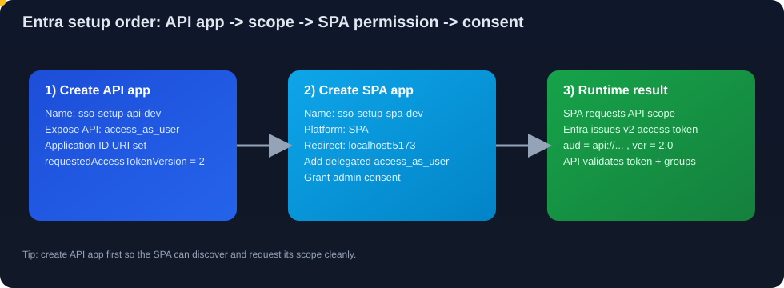
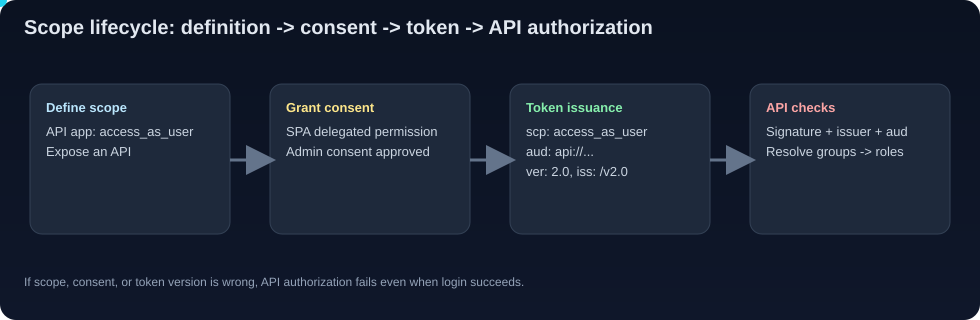

# Prerequisites

Everything you need installed and configured **before** running the SSO Setup
project. The solution is split across three repositories:

| Repo | Role | Tech |
| --- | --- | --- |
| `ui_sso_setup` | Frontend SPA | React 19, Vite 8, TypeScript 7, MSAL Browser 4 |
| `Node_sso_setup` | Backend API | Node.js, Express 4, jsonwebtoken, jwks-rsa, pg |
| `DB_sso_setup-Public` | Database | PostgreSQL 14+ (`authz` schema) |

---

## 1. Local tooling

| Tool | Minimum version | Check | Notes |
| --- | --- | --- | --- |
| Node.js | 20 LTS (22 recommended) | `node -v` | Backend uses `node --watch`; frontend needs Node 20.19+ for Vite 8 |
| npm | 10+ | `npm -v` | Ships with Node |
| PostgreSQL | 14+ | `psql --version` | Needs the `pgcrypto` extension (bundled) |
| Git | any | `git --version` | To clone the three repos |
| Azure CLI | 2.55+ | `az version` | Optional, for inspecting/patching app registrations |

---

## 2. PostgreSQL database

1. A running PostgreSQL server on `localhost:5432`.
2. A database named `sso_authz`.
3. A login role the API connects as (example uses `underwriteiq`).

```bash
# Create role + database (run as a superuser, e.g. postgres)
createuser underwriteiq --pwprompt
createdb sso_authz -O underwriteiq
```

4. Apply the schema and seed from the `DB_sso_setup-Public` repo:

```bash
psql -h localhost -U underwriteiq -d sso_authz -f DB_sso_setup-Public/schema.sql
psql -h localhost -U underwriteiq -d sso_authz -f DB_sso_setup-Public/seed.sql
```

The schema creates the `authz` schema with: `roles`, `permissions`,
`role_permissions`, `users`, `ad_groups`, `group_role_mappings`,
`user_role_overrides`, and `audit_log`.

> The backend also auto-seeds the `admin` and `user` roles on startup, so the
> app works even if `seed.sql` is skipped.

---

## 3. Cloud app registrations (Microsoft Entra ID)

You need **two** app registrations in the **same tenant**. One represents the
browser SPA (the client that logs the user in); the other represents the
protected API (the resource the token is issued *for*).

### Tenant
- Tenant ID: `cbefc6e7-8767-4c46-bc8e-2b1aaea75778`

### App 1 — SPA (frontend / public client)
| Setting | Value |
| --- | --- |
| Name | `sso-setup-spa-dev` |
| Client ID | `f809e6eb-b5d7-4f17-8bb6-0d107af282e1` |
| Supported account types | Single tenant (this org only) |
| Platform | **Single-page application (SPA)** |
| Redirect URI | `http://localhost:5173` |
| Post-logout redirect URI | `http://localhost:5173` |
| Client secret | **None** — SPA uses auth code + PKCE |
| API permissions | Delegated → `access_as_user` (from App 2) → **grant admin consent** |

### App 2 — API (backend / resource server)
| Setting | Value |
| --- | --- |
| Name | `sso-setup-api-dev` |
| Client ID | `47f29847-b7ad-4121-8b31-5098b36e63f1` |
| Application ID URI | `api://47f29847-b7ad-4121-8b31-5098b36e63f1` |
| Exposed scope | `access_as_user` (Admins and users can consent) |
| Authorized client app | Pre-authorize the SPA client ID (optional, skips consent prompt) |
| **`api.requestedAccessTokenVersion`** | **`2`** ← critical, see below |

> **v2 access tokens are required.** If the API app's
> `requestedAccessTokenVersion` is `null`/`1`, Azure issues v1 tokens
> (`iss=https://sts.windows.net/...`, `ver=1.0`) and the backend rejects them
> with `jwt issuer invalid`. Confirm/fix with:
>
> ```bash
> az rest --method GET \
>   --url "https://graph.microsoft.com/v1.0/applications(appId='47f29847-b7ad-4121-8b31-5098b36e63f1')?$select=api" \
>   --query api.requestedAccessTokenVersion -o tsv
> # If not 2, patch it:
> az rest --method PATCH \
>   --url "https://graph.microsoft.com/v1.0/applications(appId='47f29847-b7ad-4121-8b31-5098b36e63f1')" \
>   --body '{"api":{"requestedAccessTokenVersion":2}}'
> ```

### How the two registrations relate
- The **SPA** signs the user in and requests the scope
  `api://47f29847-.../access_as_user`.
- Entra issues an access token whose **audience is the API app**, **signed for
  v2**, carrying the user's **group** membership.
- The **API** validates that token (issuer = v2, audience = API app) and maps
  groups → roles.

### Animated setup view



---

## 3a. Step-by-step: create App 2 (API app) first

Create the API app first so the SPA can request its scope.

1. Open **Microsoft Entra admin center** → **App registrations** → **New registration**.
2. Name it `sso-setup-api-dev`.
3. Select **Accounts in this organizational directory only**.
4. Register.
5. Open **Expose an API**:
   - Set **Application ID URI** = `api://47f29847-b7ad-4121-8b31-5098b36e63f1`
   - Add scope:
     - Scope name: `access_as_user`
     - Who can consent: `Admins and users`
     - Admin consent display name: `Access Node SSO API`
     - Admin consent description: `Allows the app to call Node SSO API as the signed-in user`
     - User consent display name: `Access Node SSO API`
     - User consent description: `Allow this app to call Node SSO API for you`
     - State: `Enabled`
6. Open **Manifest** and ensure:
   - `accessTokenAcceptedVersion` or `requestedAccessTokenVersion` equivalent is `2`
   - Save.

> This step is mandatory for v2 tokens. If skipped, the backend can fail with
> issuer mismatch (`sts.windows.net` v1 token against v2 issuer validation).

### Validate API app configuration by CLI

```bash
az ad app show --id 47f29847-b7ad-4121-8b31-5098b36e63f1 --query "{appId:appId,identifierUris:identifierUris}" -o json
az rest --method GET \
  --url "https://graph.microsoft.com/v1.0/applications(appId='47f29847-b7ad-4121-8b31-5098b36e63f1')?$select=api" \
  --query "api.oauth2PermissionScopes[].value" -o tsv
```

---

## 3b. Step-by-step: create App 1 (SPA app)

1. Open **Microsoft Entra admin center** → **App registrations** → **New registration**.
2. Name it `sso-setup-spa-dev`.
3. Select **Accounts in this organizational directory only**.
4. Register.
5. Open **Authentication**:
   - Add platform: **Single-page application**
   - Redirect URI: `http://localhost:5173`
   - Front-channel logout URL (optional): `http://localhost:5173`
6. Open **API permissions**:
   - Add permission → **My APIs** → select `sso-setup-api-dev`
   - Choose delegated permission `access_as_user`
   - Click **Grant admin consent**
7. (Optional but recommended) in API app **Expose an API** →
   **Authorized client applications**, pre-authorize SPA client ID
   `f809e6eb-b5d7-4f17-8bb6-0d107af282e1` for `access_as_user`.

### Validate SPA configuration by CLI

```bash
az ad app show --id f809e6eb-b5d7-4f17-8bb6-0d107af282e1 --query "{appId:appId,spa:spa.redirectUris,requiredResourceAccess:requiredResourceAccess}" -o json
```

---

## 3c. Scope design requirements

Use one delegated scope for this reference app: `access_as_user`.

Rules:
- Scope must be on the API app, not the SPA app.
- Scope value should be stable; changing it requires frontend env updates
  (`VITE_API_SCOPE`) and re-consent.
- Keep scopes business-oriented (for larger systems: `policy.read`,
  `policy.write`, `admin.manage`), then map scopes to API-level authorization
  policy.
- Do not use app roles for this implementation's authorization path; this
  solution uses **groups → DB roles**.



---

## 3d. Consent and token validation checklist

Before testing login:

1. API app has `access_as_user` scope enabled.
2. SPA app has delegated permission to that scope.
3. Admin consent is granted.
4. API app token version is v2 (`requestedAccessTokenVersion=2`).
5. API app has groups claim configured for access tokens.

Quick verification after login (browser devtools/network):

- Access token `aud` = `api://47f29847-b7ad-4121-8b31-5098b36e63f1`
- Access token `ver` = `2.0`
- Access token `iss` = `https://login.microsoftonline.com/<tenant>/v2.0`
- Access token includes `groups` array with Entra group Object IDs

---

## 4. AD group requirements

Authorization is driven entirely by **Entra security-group membership**, so the
groups and the groups claim must be set up correctly.

### Required groups
| Group | Type | Object ID | Grants role |
| --- | --- | --- | --- |
| `SSO_SETUP_ADMIN` | Security | `6637f07b-c9a4-41f7-9149-27f6d501b753` | `admin` |
| `SSO_SETUP_USER` | Security | `533975f0-640b-491e-a273-3aef32cd81f3` | `user` |

Requirements:
- Groups must be **Security** groups (not Microsoft 365 / mail-enabled).
- Each test user must be a **member** of at least one group; a user in no mapped
  group resolves to **zero roles** and sees the locked/Access-Denied state.
- The group **Object ID** (not the name) is what the DB maps to a role.
- Admin membership is additive: `SSO_SETUP_ADMIN` → `admin`, which includes all
  underwriter (`user`) capability.

### Enable the groups claim (required)
The access token must contain a `groups` array, or the backend can't resolve any
role (`payload.groups` would be empty).

On the **API app** registration → **Token configuration** →
**Add groups claim**:
- Select **Security groups**.
- Under **Access** token type, choose to emit **Group ID** (the Object ID).
- Save.

> If a user is a member of a very large number of groups, Entra emits a `_claim_names`
> "group overage" reference instead of the `groups` array. For this demo keep
> membership small, or switch to the Microsoft Graph `memberOf` lookup if you hit
> the overage limit.

### Verify a user's effective mapping
```bash
PGPASSWORD=<DB_PASSWORD> psql -h localhost -U underwriteiq -d sso_authz -c \
"SELECT g.group_name, g.group_object_id, r.role_key
 FROM authz.group_role_mappings m
 JOIN authz.ad_groups g ON g.id = m.ad_group_id
 JOIN authz.roles r ON r.id = m.role_id;"
```

---

## 5. Environment files

### `Node_sso_setup/.env`
```env
PORT=3001
AZURE_TENANT_ID=cbefc6e7-8767-4c46-bc8e-2b1aaea75778
AZURE_CLIENT_ID=47f29847-b7ad-4121-8b31-5098b36e63f1
AZURE_AUDIENCE=api://47f29847-b7ad-4121-8b31-5098b36e63f1
AZURE_ISSUER=https://login.microsoftonline.com/cbefc6e7-8767-4c46-bc8e-2b1aaea75778/v2.0
ALLOWED_ORIGINS=http://localhost:5173
AUTHZ_DB_URL=postgresql://underwriteiq:<DB_PASSWORD>@localhost:5432/sso_authz
# Optional bootstrap so the first admin can reach the admin UI:
BOOTSTRAP_ADMIN_GROUP_IDS=6637f07b-c9a4-41f7-9149-27f6d501b753
```

### `ui_sso_setup/.env`
```env
VITE_AZURE_TENANT_ID=cbefc6e7-8767-4c46-bc8e-2b1aaea75778
VITE_AZURE_CLIENT_ID=f809e6eb-b5d7-4f17-8bb6-0d107af282e1
VITE_AZURE_AUTHORITY=https://login.microsoftonline.com/cbefc6e7-8767-4c46-bc8e-2b1aaea75778/v2.0
VITE_API_SCOPE=api://47f29847-b7ad-4121-8b31-5098b36e63f1/access_as_user
VITE_API_BASE_URL=http://localhost:3001
```

> Never commit real secrets. Keep the DB password out of source control and use
> a `.env.example` for sharing.

---

## 6. Install dependencies

```bash
cd Node_sso_setup && npm install
cd ../ui_sso_setup && npm install
```

---

## 7. Bootstrapping the first admin (chicken-and-egg)

Roles come from DB `group_role_mappings`. With an empty table a brand-new user
has **no roles** and cannot open the admin UI to create the first mapping.
Resolve it one of two ways:

- **Env bootstrap:** set `BOOTSTRAP_ADMIN_GROUP_IDS` to the admin group Object
  ID (see above). Members of that group get `admin` automatically.
- **Direct DB seed:** insert one admin mapping manually:

  ```sql
  WITH g AS (
    INSERT INTO authz.ad_groups (group_object_id, group_name)
    VALUES ('6637f07b-c9a4-41f7-9149-27f6d501b753'::uuid, 'SSO_SETUP_ADMIN')
    ON CONFLICT (group_object_id) DO UPDATE SET group_name = EXCLUDED.group_name
    RETURNING id
  )
  INSERT INTO authz.group_role_mappings (ad_group_id, role_id)
  SELECT g.id, r.id FROM g, authz.roles r WHERE r.role_key = 'admin'
  ON CONFLICT DO NOTHING;
  ```

After the first admin can log in, add the remaining mappings from
**Administration → Group Mappings** in the UI.

---

## 8. Checklist before first run

- [ ] PostgreSQL running, `sso_authz` created, `schema.sql` applied
- [ ] Both Azure app registrations exist; API `requestedAccessTokenVersion = 2`
- [ ] Groups claim enabled on the API app token configuration
- [ ] Test user is a member of `SSO_SETUP_ADMIN` and/or `SSO_SETUP_USER`
- [ ] `.env` files created in both `Node_sso_setup` and `ui_sso_setup`
- [ ] `npm install` run in both repos
- [ ] At least one admin mapping seeded (env bootstrap or SQL)
- [ ] Browser site data for `localhost` cleared so a fresh **v2** token is issued
