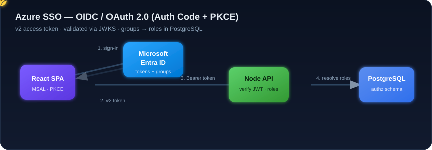
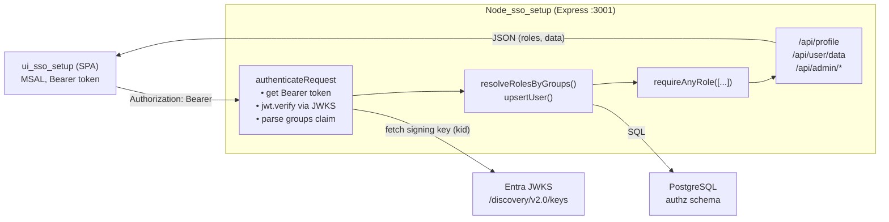
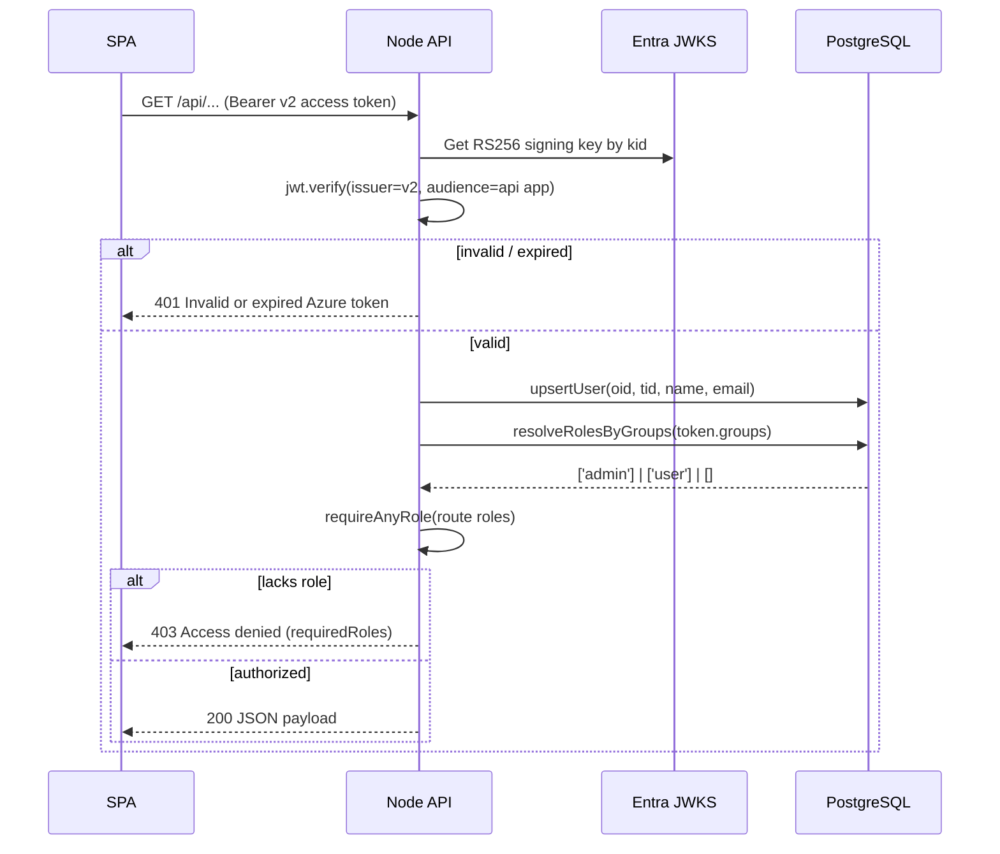

# Node SSO Setup — Authorization API


Express API that validates **Microsoft Entra ID** access tokens and resolves
**Azure AD group membership into application roles** using a PostgreSQL database.
It is the backend of a three-repository SSO reference system.

<p align="center">
  
</p>

> The diagram above is an animated SVG (a JWT travels SPA → Entra ID → API → DB).
> It animates on GitHub and in the VS Code Markdown preview.

> Full cloud setup checklist (app registrations, scopes, consent, groups):
> [PREREQUISITES.md](PREREQUISITES.md)

## Part of a 3-repository system

| Layer | Repository | Description |
| --- | --- | --- |
| Frontend (SPA) | [ui_sso_setup](https://github.com/Peddin5739/ui_sso_setup) | React + MSAL sign-in and role-based UI |
| **Backend (API)** | **Node_sso_setup** (this repo) | Express API, token validation, authorization |
| Database | [DB_sso_setup-Public](https://github.com/Peddin5739/DB_sso_setup-Public) | PostgreSQL `authz` schema (groups → roles) |

---

## Authentication & authorization method

- **Protocol:** OpenID Connect (OIDC) 1.0 on top of **OAuth 2.0**.
- **Flow:** Authorization Code Flow **with PKCE** — the SPA is a public client
  (no client secret). This API is the **resource server** that consumes the
  resulting access token.
- **Identity provider:** Microsoft Entra ID (Azure AD), v2.0 endpoint.
- **Token validation:** JWT **access token (v2, `ver: 2.0`)** verified with
  `RS256` against the tenant **JWKS**; checks `issuer` =
  `https://login.microsoftonline.com/<tenant>/v2.0` and `audience` = the API app
  (`api://<api-client-id>`).
- **Authorization model:** the token's `groups` claim (Entra security-group
  Object IDs) is matched against `authz.group_role_mappings` to produce roles
  (`admin`, `user`), which gate each route.

---

## Architecture



### Token validation & role resolution flow



---

## API endpoints

All endpoints require a valid Azure **v2** bearer token.

| Method | Path | Required role | Purpose |
| --- | --- | --- | --- |
| GET | `/api/health` | none | Liveness check |
| GET | `/api/profile` | any signed-in | Identity, groups, resolved roles |
| GET | `/api/user/data` | `user` or `admin` | Sample underwriter data |
| GET | `/api/admin/data` | `admin` | Sample admin data |
| GET | `/api/admin/roles` | `admin` | List available roles |
| GET | `/api/admin/group-role-mappings` | `admin` | List group → role mappings |
| POST | `/api/admin/group-role-mappings` | `admin` | Create/update a mapping |
| DELETE | `/api/admin/group-role-mappings/:groupObjectId/:roleName` | `admin` | Delete a mapping |

`POST` body:

```json
{ "groupObjectId": "<guid>", "roleName": "admin|user", "groupName": "optional label" }
```

---

## Configuration

Copy `.env.example` → `.env` and set:

```env
PORT=3001
AZURE_TENANT_ID=<tenant-id>
AZURE_CLIENT_ID=<api-app-client-id>
AZURE_AUDIENCE=api://<api-app-client-id>
AZURE_ISSUER=https://login.microsoftonline.com/<tenant-id>/v2.0
ALLOWED_ORIGINS=http://localhost:5173
AUTHZ_DB_URL=postgresql://<user>:<password>@localhost:5432/sso_authz
# Optional: bootstrap first admin so the admin UI is reachable
BOOTSTRAP_ADMIN_GROUP_IDS=<admin-group-object-id>
```

> The **API app registration** must have `requestedAccessTokenVersion = 2` and a
> **groups claim** enabled, otherwise v1 tokens / empty `groups` break
> validation and role resolution.

---

## Run

```bash
npm install
npm run dev      # node --watch server.js -> http://localhost:3001
```

Apply the database schema first from
[DB_sso_setup-Public](https://github.com/Peddin5739/DB_sso_setup-Public).

---

## Source map

| File | Responsibility |
| --- | --- |
| `server.js` | Express app, JWT validation, middleware, routes |
| `db.js` | `pg` pool and all `authz` queries (roles, users, mappings) |
| `.env.example` | Configuration template (no secrets) |
